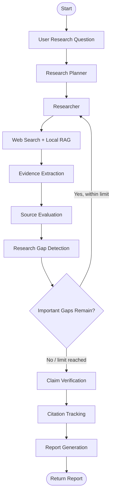

# Autonomous Research Agent

An Agentic AI research assistant built with Python, LangGraph, Groq, web search, and Retrieval-Augmented Generation (RAG). The project aims to automate research by planning subtasks, gathering relevant information, extracting evidence, evaluating sources, identifying research gaps, verifying claims, and generating structured research reports.

## Overview

Traditional research often requires manually searching multiple sources, comparing information, checking factual claims, and organizing findings. The Autonomous Research Agent aims to streamline this process through an orchestrated AI workflow.

Given a research question, the agent can organize the research process into stages and maintain shared state as information moves through the workflow. It combines LLM-based reasoning with web search and local document retrieval to support evidence-based research.

## Key Features

- **Research planning:** Breaks a research question into smaller subtasks.
- **Web research:** Searches for relevant information from external sources.
- **Local RAG:** Retrieves relevant passages from indexed documents.
- **Evidence extraction:** Identifies information relevant to the research question.
- **Source evaluation:** Assesses source relevance and credibility.
- **Research gap detection:** Identifies missing information and determines whether further research may be needed.
- **Claim verification:** Checks claims against available evidence and identifies unsupported statements.
- **Citation tracking:** Associates research findings with source references.
- **Report generation:** Organizes findings into a structured research report.
- **Graph orchestration:** Uses LangGraph to coordinate research stages and conditional transitions.

## End-to-End Workflow

The intended research workflow is:

1. **User input:** The user submits a research question.
2. **Planning:** The LLM develops a research plan with manageable subtasks.
3. **Research:** The agent gathers information through web search and local RAG retrieval.
4. **Evidence extraction:** Relevant statements are extracted and associated with their sources.
5. **Source evaluation:** Retrieved sources are assessed for relevance and credibility.
6. **Gap detection:** The agent identifies unanswered questions or insufficient evidence.
7. **Conditional research loop:** If important gaps remain, the workflow can return to research within a bounded iteration limit.
8. **Claim verification:** Claims are compared with the collected evidence.
9. **Citation tracking:** Findings are linked to source references.
10. **Report generation:** The agent assembles the findings, citations, and limitations into a report.
11. **Output:** The resulting report is returned to the user.

### Workflow Diagram



*This diagram describes the intended workflow. The exact node sequence and routing depend on the implementation in the source code.*

## Technology Stack

| Technology | Purpose |
|---|---|
| Python | Main programming language |
| LangGraph | Workflow orchestration, shared state, and conditional routing |
| Groq API | LLM inference for research-related tasks |
| SentenceTransformers | Converts text into dense vector embeddings for semantic retrieval |
| NumPy | Supports vector operations and similarity calculations |
| JSON | Stores local vector-store data and related metadata |
| RAG | Retrieves relevant context from local documents |
| Web search tools | Gather external research information |
| Streamlit | Provides the application interface, where implemented |
| python-dotenv | Loads configuration from environment variables |
| pytest | Runs automated tests, when installed |

## Project Structure

```text
Autonomous-research-agent/
├── agent/
│   ├── __init__.py
│   ├── main.py
│   ├── planner.py
│   ├── tools/
│   │   ├── __init__.py
│   │   └── web_search.py
│   ├── evidence.py
│   ├── source_evaluator.py
│   ├── gap_detector.py
│   ├── claim_verifier.py
│   ├── citation_tracker.py
│   ├── report_generator.py
│   ├── rag.py
│   ├── graph.py
│   └── state.py
├── RAG/
│   ├── __init__.py
│   ├── loader.py
│   ├── chunker.py
│   ├── embeddings.py
│   ├── retriever.py
│   ├── vector_store.py
│   ├── context.py
│   └── test_rag.py
├── data/
│   ├── quantum_topological_qubits.md
│   └── research_agent_overview.md
├── app.py
├── test_end_to_end_agent.py
├── requirements.txt
└── .gitignore
```

### Main Components

- **`agent/planner.py`** — research task planning.
- **`agent/tools/web_search.py`** — external web search integration.
- **`agent/evidence.py`** — evidence extraction.
- **`agent/source_evaluator.py`** — source assessment.
- **`agent/gap_detector.py`** — identifies missing research evidence.
- **`agent/claim_verifier.py`** — evaluates claims against available evidence.
- **`agent/citation_tracker.py`** — manages source references.
- **`agent/report_generator.py`** — report generation.
- **`agent/graph.py`** — graph-based workflow orchestration.
- **`agent/state.py`** — research state definition.
- **`RAG/`** — document loading, chunking, embedding, storage, and retrieval.
- **`app.py`** — application entry point.
- **`test_end_to_end_agent.py`** — end-to-end test suite.

## How RAG Works

Retrieval-Augmented Generation combines information retrieval with LLM generation.

1. **Load:** Read documents from the local knowledge base.
2. **Chunk:** Split documents into smaller text segments.
3. **Embed:** Convert each chunk into a dense vector using a sentence-embedding model.
4. **Store:** Save vectors and associated information in the local vector store.
5. **Retrieve:** Embed the user's query and identify relevant chunks through similarity search.
6. **Generate:** Provide retrieved context to the LLM to help answer the question.

RAG can improve factual grounding, but retrieval quality and source reliability remain important. Retrieved information and generated claims should still be checked.

## Requirements

- Python 3.10 or another Python version compatible with the project's dependencies.
- A Groq API key for live LLM inference.
- Internet connectivity for external web search and API requests.
- Project dependencies listed in `requirements.txt`.
- A local knowledge base for RAG, if document retrieval is required.

## Installation

Clone the repository:

```bash
git clone https://github.com/navadeep-05/Autonomous-research-agent.git
cd Autonomous-research-agent
```

Create and activate a virtual environment.

**Windows — Git Bash:**

```bash
python -m venv venv
source venv/Scripts/activate
```

**Windows — PowerShell:**

```powershell
python -m venv venv
.\venv\Scripts\Activate.ps1
```

Install dependencies:

```bash
python -m pip install --upgrade pip
pip install -r requirements.txt
```

## Environment Configuration

Create a `.env` file in the project root:

```env
GROQ_API_KEY=your_groq_api_key
GROQ_MODEL=your_supported_groq_model
```

Use a model currently available to your Groq account and compatible with the code.

**Security:** Never commit `.env` or expose API keys in source code, screenshots, logs, or public repositories. Keep `.env` excluded through `.gitignore`.

## Running the Application

The repository contains `app.py` as the application entry point. If it is implemented as a Streamlit application, start it with:

```bash
streamlit run app.py
```

If you want to execute the agent directly, inspect `agent/main.py` for its supported entry point and required arguments before running it.

The exact execution command depends on how the current entry-point files are implemented.

## Testing

Run the RAG tests:

```bash
python -m pytest RAG/test_rag.py -v
```

Run the end-to-end test suite:

```bash
python -m pytest test_end_to_end_agent.py -v
```

If pytest is not installed in the active environment:

```bash
python -m pip install pytest
```

Tests that use mocks can validate workflow behavior without consuming external API quota. Live API tests may consume tokens and are subject to provider limits.

## Limitations and Reliability

- Results depend on the quality and availability of retrieved sources.
- LLM outputs may contain errors even when retrieval is used.
- Source citations do not automatically prove that a claim is correct.
- External API availability and quota limits can interrupt research.
- Local RAG can only retrieve information available in its indexed documents.
- A completed graph execution does not necessarily mean every claim has been verified.
- Incomplete research should be labelled transparently rather than presented as fully verified.

## Future Improvements

- Improve quota-aware error handling and prevent unnecessary repeated API calls.
- Strengthen source provenance and claim-to-evidence validation.
- Add structured progress updates and clearer failure states.
- Improve the Streamlit interface for research progress, citations, and report downloads.
- Add deployment configuration and environment-specific settings.
- Expand automated tests for workflow failures and retrieval quality.

## Versioning

The repository's `main` branch contains the committed V2 source code, and the `v2` Git tag identifies that version.

V1 is maintained separately as an archive. Refer to the repository's Releases section for available version archives.

## License

No license has been specified yet. Add a license before granting others permission to reuse, modify, or distribute this project.

## Author

**Navadeep J**

Autonomous Research Agent — Agentic AI Project.
